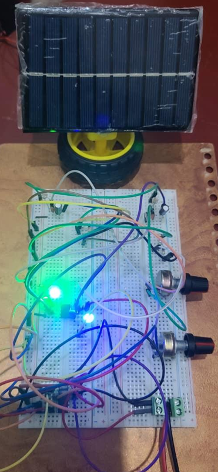
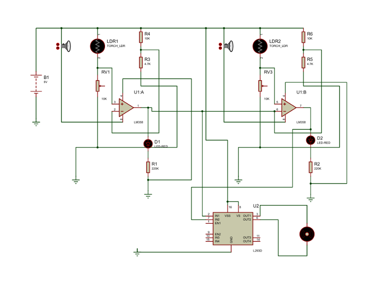

# Analog Solar Panel Light-Tracking System (LM358 Op-Amp)

-blue)

> **A low-cost, microcontroller-free autonomous solar tracking system designed with dual LM358 op-amp comparators, LDR sensing bridges, and an L293D H-bridge driver—validated via Proteus simulation and physical breadboard prototyping.**

---

## 📄 Full Technical Report
👉 **[View / Download the Complete Technical Report (PDF)](docs/Analog_Solar_Tracker_Report.pdf)**

---

## 🎯 Project Overview
Fixed solar panels lose significant energy efficiency as the sun's angle shifts throughout the day. Instead of relying on programmable microcontrollers, this project implements a purely **analog closed-loop light-tracking circuit** that continuously compares light intensity across two LDR sensors and drives a DC motor to orient the solar panel toward the strongest light source—maximizing power harvesting while minimizing system cost and complexity.

- **Institution:** Saba University — Faculty of Engineering (Mechatronics Engineering)
- **Author & Technical Developer:** Afnan Aref *(Circuit Design, Proteus Simulation & Hardware Assembly)*
- **Supervision:** Eng. Dunya Albasayr

---

## ⚙️ Circuit Schematic & Hardware Architecture

### Key Components
| Component | Specification / Value | Function in Circuit |
| :--- | :--- | :--- |
| **Dual Op-Amp IC** | `LM358` (U1:A & U1:B) | Configured as dual voltage comparators |
| **Motor Driver IC** | `L293D` Dual H-Bridge | Bidirectional DC motor actuation from comparator outputs |
| **Light Sensors** | 2× `LDR` (Light Dependent Resistors) | Directional light intensity sensing |
| **Calibration Pots** | 2× `10 kΩ` Potentiometers (`RV1`, `RV3`) | Sensitivity tuning & voltage divider balancing |
| **Reference Divider** | `10 kΩ` & `4.7 kΩ` Fixed Resistors | Generates stable comparator reference voltage ($V_{\text{ref}}$) |
| **Noise Filtering** | Decoupling Capacitors (`10 µF` & ceramic) | Signal stabilization & power-rail noise filtering |
| **Actuator & Indicators** | `5V` DC Geared Motor + Dual Status LEDs | Panel rotation and real-time comparator output monitoring |

---

## 🔄 Operating Principle
1. **Differential Light Sensing:** Each LDR forms a voltage divider with a `10 kΩ` potentiometer powered at `5V`, producing an analog output voltage ($0\text{–}3.2\text{ V}$) proportional to incident light intensity.
2. **Comparator Stage (`LM358`):** Both sensor voltages are compared against a fixed reference voltage ($V_{\text{ref}}$) set by the `10 kΩ / 4.7 kΩ` divider network.
3. **Directional Actuation (`L293D`):**
   - When **LDR1** detects stronger light, `OUT1` goes HIGH, illuminating its indicator LED and driving the DC motor in one direction.
   - When **LDR2** detects stronger light, `OUT2` goes HIGH, reversing motor polarity to track the opposite direction.
   - When light is balanced (or in darkness), both outputs match and the motor holds position to conserve energy.

---

## 📌 Note on Repository Scope
*This repository documents the analog schematic design, component selection, operating principles, and physical breadboard validation for the Op-Amp Solar Light Tracking project.*
